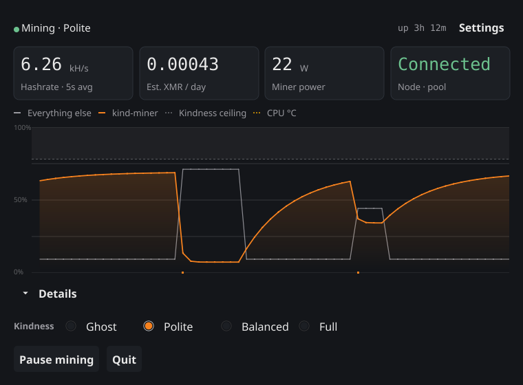
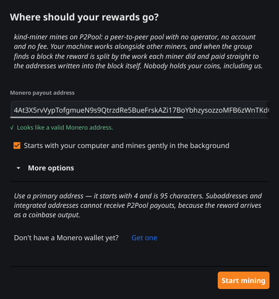

# kind-miner

**Mine Monero with the CPU capacity available that you aren't using.**  
kind-miner steps aside the moment you need your computer, and pays straight
into your own wallet — no account, no pool operator, no fee.

**[Install](#install)** · **[First run](#first-run)** · [Headless boxes](#headless-kind-minerd) · [Configuration](#configuration) · [Releases](https://github.com/d-Martian/Kind-Miner/releases)



*The dashboard. The grey line is everything else on the machine, the orange
line is the miner: when real work starts, the miner gets out of the way at
once, and only creeps back after it ends. (Demo data.)*

---

## The premise

Most of the time a computer is on, most of its CPU is doing nothing. kind-miner gives that spare capacity to Monero and hands it back the instant anything else wants it. It is not free: a busy CPU draws more power, so whether mining pays depends on what your electricity costs. What it never costs you is a smooth desktop.

Monero's RandomX algorithm is designed to favour ordinary CPUs over ASICs, so a single computer adds real hashrate. Mining runs through [P2Pool](https://p2pool.io), which pays every participant directly from the coinbase output: no pool wallet, no payout threshold, no operator who knows your address. By default it works over Tor, so neither the node nor other P2Pool nodes see your IP. Point it at your own node and it connects directly, which is faster.

---

## Features

- **Kindness, not thresholds.** One control (Ghost, Polite, Balanced or Full) sets how much of the machine mining may take and how fast it lets go.
- **Disappears under load.** Every 2 seconds it measures everything else's CPU use and gives the miner only what is left under the kindness ceiling.
- **Shows you it is doing so.** The dashboard plots the miner's CPU against everything else's, with each backoff marked.
- **Uses the right cores.** Efficiency cores while you are at the machine, performance cores once you step away, and never a second hyperthread of a core.
- **Waits for you to step away.** Until keyboard and mouse have been quiet for a while (5 minutes by default), mining is held to the Ghost ceiling.
- **Mine now, kindly.** A toggle skips that wait. The CPU, battery and temperature backoff all stay in force.
- **Says what it has earned.** Hashrate now, over 30 minutes and over 24 hours, each as an estimate of XMR per month, plus recent payouts in the tray.
- **Starts with your machine.** Optional login-item registration on Linux, macOS and Windows.
- **Backs off for heat.** A configurable temperature ceiling, plus an optional pause while the CPU is clocking itself down.
- **Battery awareness.** Pauses when unplugged. Resumes on AC.
- **Steps aside for games.** Mining pauses while a game has [GameMode](https://github.com/FeralInteractive/gamemode) on.
- **Gives memory back.** When the machine starts thrashing, the miner is stopped outright so its ~2 GB returns at once. It restarts after ten calm minutes.
- **Works without a tray.** On a desktop with no system tray, such as stock GNOME, closing the window keeps it mining, and opening kind-miner again brings the window back.
- **Snooze from the tray.** Pause for an hour, until tomorrow morning (06:00), or until you resume. A pause survives a restart.
- **Tor for onion nodes.** The default node is a Tor hidden service, so neither it nor other P2Pool nodes see your IP. Any address that isn't `.onion` is reached directly.
- **Zero-setup dependencies.** The AppImage, the Flatpak and the .deb ship XMRig, P2Pool and (on the desktop) Tor. You need only a Monero wallet address.
- **Graphical or terminal.** Double-click for a full window with setup, dashboard and settings. Launched from a terminal, it is a tray icon and logs on stdout.
- **Single native binary.** No runtime, no Python, no Electron.

More detail on each of these: [How kind-miner works](docs/how-it-works.md).

---

## Install

**You need one thing: a Monero wallet address.** It must be your wallet's
*primary* address — it starts with `4` and is 95 characters long. Many wallets
show a subaddress (starting with `8`) first; P2Pool can't pay one, so
kind-miner refuses it. [Feather](https://featherwallet.org) is recommended — it
also runs over Tor.

Then pick the install that fits the machine:

| Your machine | Install | Updates |
|---|---|---|
| A Debian, Ubuntu or Mint desktop (x86-64) | [apt](#debian-ubuntu-and-mint-apt): `kind-miner` | automatic, weekly |
| A box with no screen — a [Monero Nodo](https://moneronodo.com/), a home server — on Debian or Ubuntu (x86-64 or arm64) | [apt](#debian-ubuntu-and-mint-apt): `kind-minerd` | automatic, weekly |
| Any other Linux desktop (x86-64) | [AppImage or Flatpak](#other-linux-desktops-appimage-or-flatpak) | download each new release |
| macOS or Windows | [an archive](#macos-windows-or-a-bare-linux-binary) | download each new release |

Linux is the primary target; macOS and Windows work but are less tested.

Every file is on the [releases page](https://github.com/d-Martian/Kind-Miner/releases),
newest at the top, each with a `.sha256` beside it to check the download
against. The commands below name the current release, `0.2.0-rc10`. If the page
shows a newer one, change `VERSION` to match (without the leading `v`).

### Debian, Ubuntu and Mint: apt

There are two packages; install the one that fits the machine:

- **`kind-miner`** — the desktop app, with a window and a tray icon. amd64.
- **`kind-minerd`** — the service for a machine with no screen. amd64 and arm64.

They cannot be installed side by side: installing one removes the other, so a
machine never runs two miners.

You download the first .deb by hand, once. It adds kind-miner's own apt
repository, and from then on apt keeps it up to date.

**The desktop app:**

```sh
sudo apt update
VERSION=0.2.0-rc10
DEB=kind-miner_${VERSION}_amd64.deb
curl -fLO https://github.com/d-Martian/Kind-Miner/releases/download/v$VERSION/$DEB
curl -fLO https://github.com/d-Martian/Kind-Miner/releases/download/v$VERSION/$DEB.sha256
sha256sum -c $DEB.sha256        # go on only if this prints "OK"
sudo apt install ./$DEB tor
```

Then open **kind-miner** from your applications menu and carry on at
[First run](#first-run).

**The headless service:**

```sh
sudo apt update
VERSION=0.2.0-rc10
DEB=kind-minerd_${VERSION}_$(dpkg --print-architecture).deb
curl -fLO https://github.com/d-Martian/Kind-Miner/releases/download/v$VERSION/$DEB
curl -fLO https://github.com/d-Martian/Kind-Miner/releases/download/v$VERSION/$DEB.sha256
sha256sum -c $DEB.sha256        # go on only if this prints "OK"
sudo apt install ./$DEB
```

apt installs `tor` along with it.

The service starts at once and waits to be set up: see
[Headless: kind-minerd](#headless-kind-minerd).

Upgrading, removing and troubleshooting the apt packages: [Install notes](docs/install.md).

### Other Linux desktops: AppImage or Flatpak

Both carry XMRig, P2Pool and Tor, so nothing is downloaded when you first run
them. Neither updates itself: when a new release is out, download it the same
way.

**AppImage** — one file, nothing to install:

```sh
VERSION=0.2.0-rc10
APP=kind-miner-v${VERSION}-linux-x86_64.AppImage
curl -fLO https://github.com/d-Martian/Kind-Miner/releases/download/v$VERSION/$APP
curl -fLO https://github.com/d-Martian/Kind-Miner/releases/download/v$VERSION/$APP.sha256
sha256sum -c $APP.sha256
chmod +x $APP
./$APP --gui
```

The first time it runs it adds itself to your applications menu, so after that
you can start it from there. Keep the file where it is: the menu entry points
at it.

**Flatpak** — needs `flatpak` installed; the runtime comes from Flathub:

```sh
VERSION=0.2.0-rc10
PAK=kind-miner-v${VERSION}-linux-amd64.flatpak
curl -fLO https://github.com/d-Martian/Kind-Miner/releases/download/v$VERSION/$PAK
curl -fLO https://github.com/d-Martian/Kind-Miner/releases/download/v$VERSION/$PAK.sha256
sha256sum -c $PAK.sha256
flatpak install --user $PAK
```

Then open **kind-miner** from your applications menu, or run
`flatpak run io.github.d_Martian.KindMiner`. For a later release, install
its bundle the same way (add `--reinstall` if flatpak says it is already
installed).

### macOS, Windows, or a bare Linux binary

These archives hold the program alone, with this README and
`config.example.yaml`. On first run it downloads the pinned XMRig and P2Pool
and checks their SHA256 before using them.

**Tor is not included**, so install it first: kind-miner starts it for you, but
it needs the program to be there. (It also uses a Tor already listening on
`127.0.0.1:9050`.)

| Platform | Archive | Tor |
|---|---|---|
| macOS, Apple silicon | `kind-miner-v<VERSION>-darwin-arm64.tar.gz` | `brew install tor` |
| macOS, Intel | `kind-miner-v<VERSION>-darwin-amd64.tar.gz` | `brew install tor` |
| Windows | `kind-miner-v<VERSION>-windows-amd64.zip` | `tor.exe` from the [Tor Expert Bundle](https://www.torproject.org/download/tor/), on your `PATH` or in a `bin` folder beside `kind-miner.exe` |
| Linux (x86-64) | `kind-miner-v<VERSION>-linux-amd64.tar.gz` | `sudo apt install tor`, `sudo dnf install tor` or `sudo pacman -S tor` |

On macOS, for example:

```sh
VERSION=0.2.0-rc10
NAME=kind-miner-v${VERSION}-darwin-arm64     # -darwin-amd64 on an Intel Mac
curl -fLO https://github.com/d-Martian/Kind-Miner/releases/download/v$VERSION/$NAME.tar.gz
curl -fLO https://github.com/d-Martian/Kind-Miner/releases/download/v$VERSION/$NAME.tar.gz.sha256
shasum -a 256 -c $NAME.tar.gz.sha256
tar xzf $NAME.tar.gz
$NAME/kind-miner --gui
```

On Windows, unzip the archive and double-click `kind-miner.exe`.

---

## First run

### In the window

1. Open kind-miner — from the applications menu, or by double-clicking it.
2. Paste your wallet's primary address.
3. Under it, a ticked box says it **starts with your computer and mines gently
   in the background**. Untick it if you'd rather start it yourself.
4. Press **Start mining**.



That is the whole setup. **More options** lets you use your own Monero node
instead of ours over Tor; everything else starts from a default — the
automatic node, the nano sidechain, the bundled engines, the Polite preset,
and pausing on battery — and all of it can be changed later in Settings.

Once mining has started, the window tucks into the system tray and a
notification says where it went. On a desktop with no tray, such as stock
GNOME, closing the window keeps it mining; open kind-miner again from your
apps to bring the window back. Launching it a second time always shows the
one already running rather than starting a second miner.

### From a terminal

Launched from a terminal, kind-miner shows a tray icon and logs to stdout, and
on first run asks for your address in the terminal instead of the window:

```sh
kind-miner                 # tray icon, logs on stdout; first run is a short text wizard
kind-miner --gui           # the full window, even from a terminal
kind-miner --no-tray       # no GUI at all, for servers and SSH (--headless is an alias)
kind-miner --config PATH   # use a config file somewhere else
kind-miner --version
```

(For the AppImage or an unpacked archive, run it by its path, as above.)
Started with no config and neither a terminal nor a display — as a service,
say — it writes a config template for you to edit instead: see
[Configuration](#configuration). For a machine that never has a screen,
[kind-minerd](#headless-kind-minerd) is the better fit: it is the same miner
built without the GUI, and the apt package runs it as a service.

---

## Kindness

Kindness is the one thing kind-miner asks you to understand. Each preset is a
**ceiling** — the share of the whole machine that mining and everything else may
occupy together — plus how fast the miner gives ground and how slowly it takes
it back.

| Preset | Ceiling | What it feels like |
|---|---|---|
| **Ghost** | 52% | Only genuinely idle cycles. You will never notice it; payouts are slow. |
| **Polite** | 78% | Steps aside the moment you touch the machine, and comes back slowly. The default, and the one most people keep. |
| **Balanced** | 90% | Shares the machine evenly. Heavy work still wins, but you may feel a short lag. |
| **Full** | 100% | Every core, straight away — it doesn't wait for you to step away. Still yields to your apps and gives the CPU back slowly. For machines you are not sitting at. |

The formula behind the presets, and how the limit is applied: [How kind-miner works](docs/how-it-works.md#how-kindness-is-applied).

---

## Headless: kind-minerd

For a box with no screen — a Nodo, a home server — there is `kind-minerd`, the same miner without the window. Install it on Debian or Ubuntu [with apt](#debian-ubuntu-and-mint-apt); the package runs it as a service and keeps it current.

Setup, commands, updates, running it as a service by hand, and one hub for several computers: [Headless: kind-minerd](docs/headless.md).

## Sleep

kind-miner mines while your machine is awake and stops when it sleeps. It never keeps a machine awake, and we don't suggest turning sleep off to mine more: a kind miner uses the time you leave it, not time it takes.

---

## Getting the full hashrate

RandomX keeps a ~2 GB dataset and a 2 MiB scratchpad per mining thread, and walks them at random. On the default 4 KiB memory pages that walk misses the TLB constantly, and the miner gives up a large fraction of its hashrate for it. Reserving **huge pages** is the single biggest thing you can do for your rate.

Size the pool for **both** processes. kind-miner runs xmrig *and* p2pool, and p2pool verifies shares with RandomX too. It runs in light mode, so it keeps two 256 MiB caches rather than a second 2 GB dataset, but it starts first. A pool sized for the miner alone loses those pages to p2pool, and the miner silently falls back to 4 KiB pages — the exact thing you were trying to avoid. kind-miner warns at startup when this happens and prints the number to use.

Roughly: 2,080 MiB for the miner's dataset, 2 MiB per mining thread, and about 520 MiB for p2pool. For a 12-thread miner that is around 2,620 MiB — 1,310 pages of 2 MiB, so 1,400 leaves a little slack. Do not over-reserve: pages in the huge page pool are held out of normal use whether or not anything is using them, so the difference comes straight off the RAM available to everything else.

**Linux**
```sh
# Reserve the pages on every boot
echo 'vm.nr_hugepages = 1400' | sudo tee /etc/sysctl.d/99-kind-miner-hugepages.conf
sudo sysctl --system

# Check what you actually got
grep HugePages_Total /proc/meminfo
```

Setting this on a machine that has been up for a while often falls short of what you asked for: memory is fragmented and the kernel cannot find enough contiguous blocks. The drop-in above is applied at boot, when memory is clean — so if the number comes back low, reboot rather than raising it further.

### Compared with other miners

A dedicated miner such as Gupax shows a higher hashrate on the same machine, and it should: the difference is kind-miner keeping out of your way, on purpose. (Run as root, Gupax's xmrig can also set CPU registers for another 10–15%; kind-miner never runs as root.)

- **While you're using the computer**, kind-miner mines on the efficiency cores only, at the Ghost ceiling (52%), until the keyboard and mouse have been quiet for `idle_full_after_seconds` (5 minutes by default). The dashboard says so — "Mining gently on 8 of 12 cores · all 12 at Balanced in ~5m". Leave the machine for five minutes and it moves to every core.
- **Kindness**: Balanced leaves 10% of the machine free, Polite 22%. Full uses all of it, and **Full does not wait for you to step away**: it mines on every core straight away, like a dedicated miner, while still running at the lowest priority and giving the CPU to your apps whenever they want it.

---

## Mining over Wi-Fi

If you mine over Wi-Fi, check whether the radio runs with 802.11 power save on:

```sh
iw dev <interface> get power_save
```

With power save on the radio sleeps between beacons and has to be woken to be serviced. A busy CPU delays that path, the card misses its service windows, and traffic queues for **seconds at a time**. The effect is bursty rather than constant, so the median stays healthy while anything needing many round trips — loading a page, bringing up a VPN — fails outright. It reads exactly like a broken internet connection, which is the trap: the machine looks fine, the router looks fine, and only the one machine that is mining is affected.

Measured on one laptop: hashing drove round trips to the local router — one hop, no internet involved — from 4 ms to over 14 seconds, with a fifth of packets taking more than a second. With power save off and nothing else changed, latency under the same load was indistinguishable from idle.

```sh
sudo nmcli con modify "<connection>" wifi.powersave 2
sudo iw dev <interface> set power_save off
```

kind-miner warns at startup when it sees this. Keeping the radio awake costs a little idle battery; the setting is per-connection, so you can disable it only on the networks you mine over.

---

## Configuration

Config lives at `~/.config/kind-miner/config.yaml` on Linux and macOS — or `$XDG_CONFIG_HOME/kind-miner/config.yaml` if you set that variable — and at `%APPDATA%\kind-miner\config.yaml` on Windows. A config already in `~/.config/kind-miner` keeps being used until there is one in the `XDG_CONFIG_HOME` folder, and the Flatpak always uses `~/.config/kind-miner`, so it shares one config with the other builds.

```yaml
# Your wallet's primary address. Required. It starts with 4 and is 95
# characters long; subaddresses (8…) and integrated addresses are refused,
# because P2Pool pays in the coinbase, which only a primary address receives.
wallet: "4..."

# Connection mode: p2pool-remote | p2pool-local | hub
mode: p2pool-remote

# p2pool-remote: which monerod node p2pool connects to.
# Leave blank to choose automatically: a synced local monerod with ZMQ, else the default node over Tor.
remote_node: ""

# P2Pool sidechain: "nano" (the default; its 18-hour window keeps even a
# laptop paid), "mini" for a busier chain, "main" above ~50 kH/s.
p2pool_chain: nano

# Set to true to let kind-miner manage the p2pool subprocess.
manage_p2pool: true

# Maximum XMRig threads. 0 = auto — min(logical cores, L3 / 2 MiB), which is
# the most RandomX can use before threads start evicting each other (recommended).
max_threads: 0

# How much of the machine mining may take, and how fast it lets go.
# ghost | polite | balanced | full — see "Kindness" above.
kindness: polite

# Pause when running on battery.
pause_on_battery: true

# Pause while the CPU is clocking itself down for heat.
pause_on_thermal_throttle: true

# Mine only while the screen is locked.
mine_only_when_locked: false

# Pause if any CPU core exceeds this temperature (Celsius).
temp_limit_celsius: 95

# Mine as a guest on a Nodo (or any big.LITTLE box that serves a Monero node):
# low-power cores first, big cores only while monerod and monero-lws are not
# waiting for CPU, nothing while the node syncs, and a 70 °C ceiling. Opt-in,
# config file only. Needs a restart.
mine_on_nodo: false

# hub mode: the code `kind-minerd pair` printed, and this machine's name there.
hub_code: ""
worker_name: ""

# Be a hub (headless boxes): serve p2pool on the LAN over TLS.
hub:
  serve: false
  stratum_port: 18087
  api_port: 18088
  onion: false   # also serve both as a Tor onion, for devices away from home

# Dashboard chart — display only.
chart:
  shade_headroom: true
  mark_backoff: true
  draw_temperature: false
  fill_miner: true
  window_seconds: 30

log_level: info
```

Everything here except `mine_on_nodo` and `hub` (headless-box settings) is editable
from the settings window, which groups it the same
way: **Payout**, **Connection**, **Binaries**, **Kindness**, **Graph**,
**Advanced**. Kindness and graph settings take effect while you watch; wallet,
mode, node, hub code and sidechain need a restart, and the window says so when you save.

kind-miner only rewrites the keys it owns, so anything you add by hand is kept.

---

## Connection modes

### `p2pool-remote` (default)

```
XMRig → p2pool (local) ──Tor──→ default node (.onion) → Monero network
```

P2Pool runs on your machine. By default it follows kind-miner's [default node](#the-default-node) — a Monero full node running as a Tor hidden service, with ZMQ enabled for p2pool — so the node never sees your IP. Payouts arrive directly in your wallet from the P2Pool sharechain. No fee.

**A node on this machine comes first.** With no `remote_node` set, kind-miner looks for a monerod already running here before anything else. If it is synced and publishes ZMQ (`monerod --zmq-pub tcp://127.0.0.1:18083`), p2pool uses it directly and Tor is never started. If it is still syncing, has no ZMQ, or wants an RPC login, the log says which and what to change, and mining uses the default node in the meantime. kind-miner keeps checking once a minute and moves p2pool onto the local node, off Tor, as soon as it is ready — or if you start one later — without a restart.

**Tor only for onions.** A `remote_node` on your LAN or the open internet is reached directly; only a `.onion` address goes through Tor, which kind-miner starts for you when it is needed.

### `p2pool-local`

```
XMRig → p2pool (local) → monerod (local) → Monero network
```

You run your own `monerod` locally. Maximum trustlessness — you validate every block yourself. Requires ~180 GB of disk space and 1–3 days for initial sync.

Set `manage_monerod: true` to have kind-miner start and stop `monerod` for you.

### `hub`

```
XMRig ──TLS, LAN──→ p2pool on the hub → the hub's monerod
```

Only XMRig runs here; the hub (see [One hub for several computers](docs/headless.md#one-hub-for-several-computers)) does the rest, and pays its owner's wallet. No Tor, because nothing leaves the LAN from this machine.

### No `pool` mode

Earlier versions could send XMRig straight to a Stratum pool. That told the pool operator your wallet address, paid them a fee, and connected outside Tor, so it has been removed. A config that still says `mode: pool` is moved to `p2pool-remote` when it loads, with one line in the log. If your machine is too slow for P2Pool shares to arrive often — the reason pool mode used to be suggested — set `p2pool_chain: nano`.

---

## How the scheduler works

```
every 2 seconds:
  other_cpu = total_cpu% - xmrig_cpu%     ← other processes only

  if manually paused                      → allowance 0
  if on battery and pause_on_battery      → allowance 0
  if any core temp >= temp limit          → allowance 0
  if thermally throttled and asked to     → allowance 0
  if screen unlocked and asked to         → allowance 0
  else:
    ceiling = kindness ceiling            ← Ghost's, until you have gone idle
    target  = max(0, ceiling - other_cpu)
    allowed += (target - allowed) x (target < allowed ? Fall : Rise)

  threads = floor(allowed x cores), capped at max_threads
  0 threads → suspend (SIGSTOP, instant)
  fewer     → applied immediately
  more      → only after several ticks agree (it restarts XMRig)
```

XMRig also runs at OS idle priority (`nice 19` on Linux/macOS,
`IDLE_PRIORITY_CLASS` on Windows). The scheduler is a second, independent layer
on top of that. The combination means the miner loses scheduler fights to
anything — including background browser tabs — and then explicitly hands back
CPU if load climbs further.

On Linux it goes further, since nice 19 still takes a real share of a busy core:

- **CPU:** XMRig runs in its own idle-weighted systemd user scope (`cpu.idle=1`), so any app in your session preempts it outright. Inside Flatpak, or without a systemd user session, its threads run under `SCHED_IDLE` instead.
- **Memory:** its OOM score is 1000, so if memory runs out the kernel kills the miner first, not what you are working in.
- **Disk:** its I/O is in the idle class, served only when nothing else wants the disk.

None of this needs root, and none of it changes the hashrate on an idle machine.

The tray icon reflects state in real time:

| Icon | State | Meaning |
|---|---|---|
| 🟠 colour | Mining | Running at its full thread count |
| 🟠 dim | Stepping aside | Running at fewer threads than allowed |
| ⚫ grey | Paused | Suspended — load, battery, heat, or you |
| ⚫ grey, amber badge | Held | p2pool is mining alone on a sidechain of its own, so shares would never pay. The menu says why; mining resumes by itself once the check passes |

p2pool on an island looks like healthy mining: it takes every share and never
pays, because nobody else is on its chain. Once a minute kind-miner checks that
p2pool has peers, that the sidechain is long and still moving, and that the pool
is much bigger than this machine. If any check fails for three minutes, mining
is held until they pass again.

---

## The resource chart

The dashboard draws the last 30 seconds (or 60, or 2 minutes) of two series:
every other process's CPU, and the miner's. The band above the kindness ceiling
is shaded — that is the part of the machine mining will not touch — and each
moment the miner handed CPU back is ticked along the bottom.

This exists because the failure mode that costs a user the most is deciding some
unrelated slowdown is the miner's fault and uninstalling it. Watching the orange
line dive the instant the grey one climbs is a better answer to that than any
status line.

Fyne 2.5.3 has no chart widget, so the plot is rasterised with
`golang.org/x/image/vector` and handed to a `canvas.Raster`
(`internal/gui/chart.go`).

**A note on the power figures.** Since CVE-2020-8694 the Linux kernel ships the
RAPL energy counters as root-only, because they are precise enough to infer what
other processes are computing. kind-miner does not ask for privileges to read
them, so on most machines the power tiles show `—`. Where the counters *are*
readable, the miner's share is attributed proportionally to CPU — an
approximation, exact only at the extremes. A modelled wattage presented next to
a measured hashrate would be indistinguishable from a real one, so none is
shown.

---

## Privacy model

| Layer | What it protects |
|---|---|
| **Monero** | Amounts, sender and receiver are hidden by default (RingCT and stealth addresses). Coins are fungible. |
| **P2Pool** | There is no pool operator. Payouts come directly from the Monero protocol, and no operator knows your wallet address or hashrate. |
| **Tor** | With a `.onion` node (the default), the node and other P2Pool nodes do not see your IP. A node at any other address is reached directly, and it and P2Pool's peers do see your IP. |
| **kind-miner** | No telemetry, analytics, account or registration. Beyond the node and P2Pool's peers it fetches only the signed advisory: once a day, over Tor, and not at all when Tor isn't running. A bare binary also downloads its pinned engines once, on first run. The macOS, Windows and plain Linux archives use upstream XMRig, which keeps its 1% minimum donation and connects to XMRig's pool directly; the .deb, AppImage and Flatpak ship XMRig built without it. |

With the default `.onion` node, the only public trace is P2Pool's sharechain, which shows that *someone* with *some* hashrate submitted a share. Your wallet address appears in the coinbase of blocks you help find, exactly as in solo mining.

---

## Building from source

```sh
git clone https://github.com/d-Martian/Kind-Miner
cd Kind-Miner
go build -o kind-miner ./cmd/kind-miner
```

Requires Go 1.25+. The GUI uses [Fyne](https://fyne.io), which builds with cgo and
OpenGL, so the build host needs the GL/X11/Wayland development headers. On Fedora:

```sh
sudo dnf install gcc libXxf86vm-devel libX11-devel libXcursor-devel \
                 libXrandr-devel libXinerama-devel libXi-devel \
                 mesa-libGL-devel libxkbcommon-devel wayland-devel
```

(On Debian/Ubuntu the equivalents are `libgl1-mesa-dev xorg-dev libxxf86vm-dev
libxkbcommon-dev`.) The tray icons are embedded statically — no assets need to be
shipped alongside the binary.

```sh
# Run tests
go test ./...
```

---

## The default node

With no `remote_node` set and no node on this machine, kind-miner follows one Monero full node, run for this project as a Tor hidden service:

```
44yfclfdry66bbpyolux6xmfkcapage7khfk5sax7xmmylwwmjaqukad.onion
RPC  18089   ZMQ  18083
```

It runs `monerod` with ZMQ enabled — a requirement for p2pool that most public nodes skip. It is the only node in kind-miner's default list because we don't advertise nodes we can't verify. If it is temporarily unreachable, kind-miner retries automatically before giving up.

ZMQ cannot travel through a SOCKS proxy, so p2pool on its own would reach an onion node's RPC but never hear about new blocks. kind-miner therefore runs a small relay on `127.0.0.2` that carries both RPC and ZMQ to the node over Tor, with each node on its own Tor circuit. It also checks that the node really speaks ZMQ, not just that the port opens, before mining against it.

You can substitute any monerod node that has ZMQ enabled by setting `remote_node` in your config. If you run your own node on a home server, this is the cleanest option.

---

---

## Philosophy

Privacy is not a feature. It is the precondition for everything else.

Monero gives every user the same privacy by default. P2Pool removes the pool operator, who would otherwise control which transactions get confirmed. Tor is here because an IP address is metadata, and metadata has a way of becoming evidence.

You don't need something to hide to want privacy. Run the miner, collect some XMR, help keep the network decentralized, and go about your day.

---

## License

MIT. Do what you want with it.
